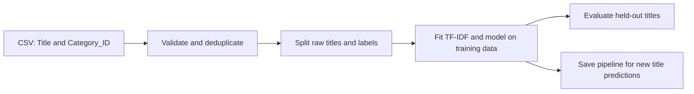
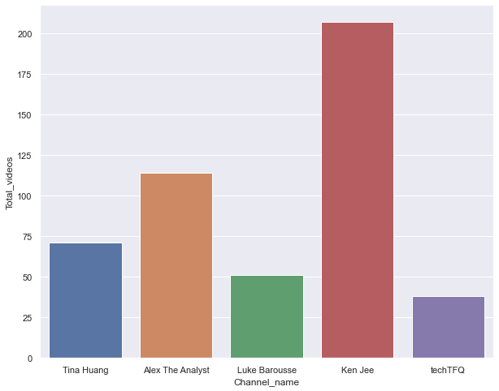
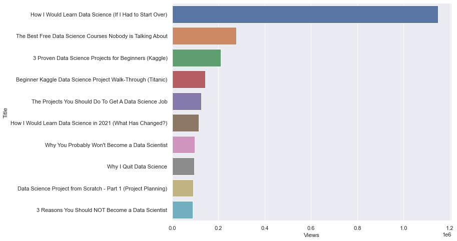
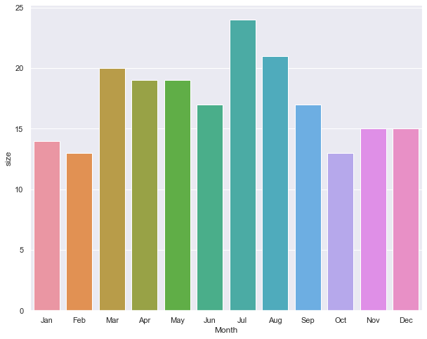

# YouTube Video Classifier

Text classification from video titles, with a local training and prediction workflow using TF-IDF and scikit-learn.


[Workflow](#workflow) · [Model comparison](#model-comparison) · [Training notebook](ML_AI_Train_Test_Code.ipynb)

## What it does

The classifier learns to distinguish titles belonging to YouTube's Education or Science & Technology categories from other categories. It uses title text and category-derived labels. It does not watch a video, check its facts or determine its teaching quality.

The project combines a historical six-model comparison and API-analysis notebook with a portable command-line workflow. The CLI trains a selected model, reports evaluation metrics and saves one pipeline that can be reloaded to classify new titles.

## Workflow



## Data and Label Definition

The learning task uses video titles as input and YouTube category IDs to define a binary target:

| Category metadata | Training label | Interpretation |
|---|---:|---|
| 27: Education | 1 | Education-category proxy |
| 28: Science & Technology | 1 | Science/technology-category proxy |
| Any other category | 0 | Other-category proxy |

This makes the experiment reproducible when the source data is available, but also limits its meaning. A useful educational video can appear outside those categories, and a video inside them may still be poor teaching material. The model learns the proxy defined by the dataset rather than an expert judgement of educational value.

A minimal input CSV looks like this:

```csv
Title,Category_ID
Understanding electric circuits,27
An introduction to computer processors,28
Live music performance,10
```

The original 4,218-row dataset is not in the repository. The supplied 40-row demonstration is synthetic and exists to make the software workflow easy to try.

## How the Model Works

TF-IDF converts words in a title into numerical features, weighing words by their frequency within a title and across the training collection. A classifier then learns patterns linking those features to the category-derived labels.

The executable splits raw titles before learning the vocabulary and feature weights. This keeps held-out titles out of preprocessing. The vectoriser and classifier are saved in one pipeline so later predictions use the same learned transformation as training.

| Stage | Behaviour |
|---|---|
| Validate | Require titles and integer category IDs; reject blank titles |
| Clean | Normalise titles for exact-duplicate detection and reject contradictory labels |
| Split | Use a fixed seed and stratification to preserve both classes |
| Fit | Learn TF-IDF and the selected model from training titles only |
| Evaluate | Record metrics against the held-out partition and a majority baseline |
| Predict | Reload the saved pipeline and accept new title text |

The original notebooks also explore multiclass category prediction. That separate task is preserved as historical work; the portable CLI has a clearly defined binary target.

## Existing Data-Analysis Visuals

The following charts are extracted unchanged from the saved YouTube analysis notebook. They show exploratory channel/video statistics at the time of that experiment, not current channel counts or classifier accuracy.

<table>
<tr><th width="50%">Channel subscriber comparison</th><th width="50%">Channel view comparison</th></tr>
<tr><td></td><td></td></tr>
<tr><th>Total published videos</th><th>Most-viewed video titles</th></tr>
<tr><td></td><td></td></tr>
</table>



The analysis notebook demonstrates API pagination, tabular data preparation, sorting and aggregation for exploratory plots. It complements the title-classification experiment without being presented as a working end-to-end dataset builder.

## Try the Classifier

Python 3.11 or 3.12:

```bash
python -m pip install -r requirements.txt
python predict.py train --data examples/demo.csv --output-dir artifacts/demo
python predict.py predict --artifact artifacts/demo/pipeline.joblib --title "How electric circuits work"
```

The included 40-row sample is synthetic. Use a CSV with `Title` and `Category_ID` columns to evaluate your own data. Prediction accepts title text. Only load model artifacts you trust.

## Models and outputs

Use `--model` to select `random-forest` (default), `naive-bayes`, `svm`, `knn`, `decision-tree` or `xgboost`. XGBoost requires `requirements-optional.txt`; the other five come from scikit-learn. KNN needs at least five training rows.

Each training run writes:

| File | Contents |
|---|---|
| `pipeline.joblib` | Fitted TF-IDF vectoriser and model together |
| `metrics.json` | Accuracy, balanced accuracy, precision/recall/F1, confusion matrix, majority baseline, seed, row counts, dataset hash and library version |

The split is stratified with a fixed seed. TF-IDF is fitted on training titles only. Exact normalized duplicates are removed before splitting and conflicting labels are rejected. This addresses the original preprocessing leak; it does not guarantee generalisation across related videos or channels.

## Model Comparison

The historical work compares six supervised models. The new CLI lets a reader run them individually on the same input and split configuration:

| CLI option | Algorithm | Useful comparison |
|---|---|---|
| `naive-bayes` | Multinomial Naive Bayes | Simple text-classification baseline |
| `random-forest` | Random Forest | Ensemble of decision trees; current default |
| `svm` | Support Vector Classifier | Margin-based classification |
| `knn` | K-Nearest Neighbours | Similarity to nearby training examples |
| `decision-tree` | Decision Tree | Single-tree baseline |
| `xgboost` | XGBoost | Boosted trees; optional dependency |

For example, run Naive Bayes without overwriting another experiment:

```bash
python predict.py train --data data/videos.csv --model naive-bayes --seed 42 --output-dir artifacts/naive-bayes
```

When comparing models repeatedly, use a validation procedure for selection and reserve an untouched test set for the final result. One repeatedly consulted test split is not an independent confirmation of the selected model's quality.

## Historical experiment

The original notebook compares six models and records **91.7% Random Forest accuracy** on an 80/20 split. This is a historical output, not a reproduced score for this revision: the dataset is missing and preprocessing was fitted before splitting. Preprocessing should be fitted on the training partition only; the portable CLI follows that order.

The updated CLI needs fresh evaluation on real data. It does not inherit the historical score.

## YouTube API analysis

[YT-Analysis.ipynb](YT-Analysis.ipynb) preserves channel/video metadata collection with pagination and exploratory plots. To work with it, install the optional dependencies:

```bash
python -m pip install -r requirements-optional.txt
export YOUTUBE_API_KEY="your-own-key"
jupyter lab
```

In PowerShell, use `$env:YOUTUBE_API_KEY="your-own-key"`. The notebook reads the key from the environment; `.env.example` is a reference and is not loaded automatically.

The collection notebook remains a historical exploration. Some optional API statistics need defensive handling, and its output lacks Category_ID required by the classifier. Live API collection was not tested in this revision. The notebooks preserve original machine-specific paths; use the CLI for the portable classification workflow.

## Reading an Evaluation Report

Accuracy gives the fraction of correct proxy predictions. Precision and recall help distinguish false positives from missed positives, and balanced accuracy helps assess performance when class sizes differ. The confusion matrix records the two classes in `[0, 1]` order.

`metrics.json` also records training/test class counts, the random seed, a dataset hash and the installed scikit-learn version. The `synthetic_demo` field marks the included example. Reported scope and reproducibility metadata are separate from evidence of real-world usefulness.

## Checks and further work

```bash
python -m unittest discover -s tests -v
```

Checks cover training-only vocabulary, conflicting duplicate labels, missing columns, and training/saving/reloading/predicting with the synthetic example. 

Next steps are restoring the original dataset with provenance, testing channel-group splits, reviewing category-derived labels with human annotations and recording a fresh evaluation before adding a demo interface.
