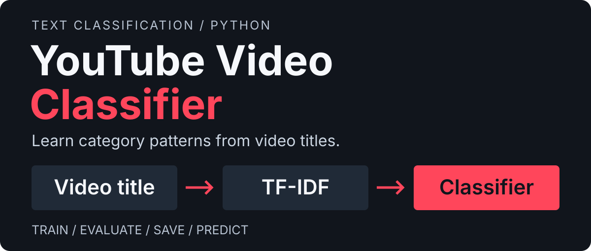
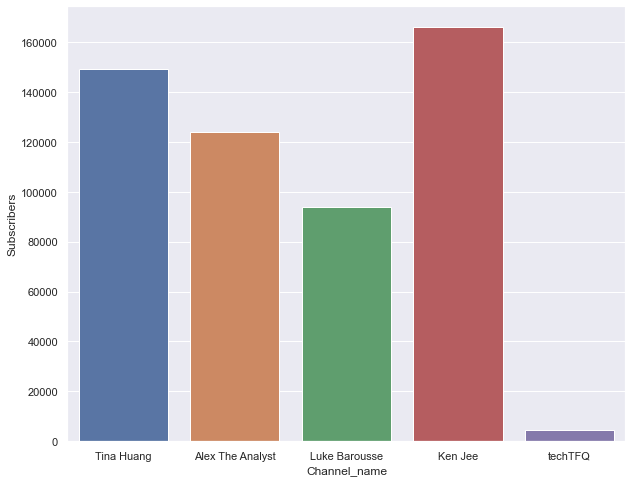
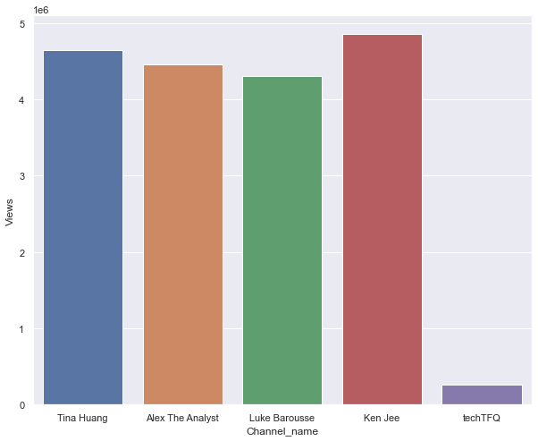

# YouTube Video Classifier

<p></p>

Train a model on video titles, compare its predictions with held-out labels, and save the pipeline for the next run.


<p align="center">
<a href="#try-it"></a>
<a href="data/README.md"></a>
<a href="docs/workflow.md"></a>
<br>
<a href="docs/historical-results.md"></a>
<a href="docs/notebook-analysis.md"></a>
</p>

## Project Summary

A video title gives a quick clue about its subject. This project asks how far those words can take a text classifier. It compares six model options using TF-IDF features, with YouTube's Education and Science & Technology categories defining the positive class.

The repository brings together the original experiments and a portable train/predict CLI. The current workflow splits titles before fitting TF-IDF, checks duplicate labels and saves the vectoriser with the classifier. A new title then follows the same preprocessing as the training data.

| Work | What you can inspect |
|---|---|
| Title classification | Six classifier options, a fixed split seed and held-out evaluation |
| Repeatable predictions | A saved scikit-learn pipeline containing preprocessing and the fitted model |
| Data exploration | Original YouTube metadata notebooks and five saved analysis plots |

## A Look at the Analysis

<table>
<tr><th width="50%">Channel subscribers</th><th width="50%">Channel views</th></tr>
<tr><td></td><td></td></tr>
</table>

These are saved exploratory plots from the analysis notebook. They describe the collected channel metadata, not classifier accuracy. [See all five plots and the analysis approach →](docs/notebook-analysis.md)

## Try It

Use Python 3.11 or 3.12. From the repository directory:

```bash
python -m pip install -r requirements.txt
python predict.py train --data examples/demo.csv --output-dir artifacts/demo
python predict.py predict --artifact artifacts/demo/pipeline.joblib --title "How electric circuits work"
```

The included 40-row sample uses invented titles so the workflow can run without an API key. Its scores are demonstration results. For your own data, follow the [CSV guide](data/README.md); model selection, output files and optional dependencies are in the [workflow guide](docs/workflow.md).

## Read the Results in Context

Predictions use YouTube category labels as a proxy for subject area, with the video title supplying the input text.

The original notebook records **91.71% Random Forest accuracy**, but the dataset is absent and TF-IDF was fitted before splitting. That historical score needs to be read with its [evaluation limits](docs/historical-results.md). The current pipeline needs a fresh real-data evaluation.

## Explore Further

- [Training data](data/README.md): columns, label mapping and validation rules.
- [Workflow and models](docs/workflow.md): training, prediction, saved artifacts and checks.
- [Historical results](docs/historical-results.md): the six-model comparison and what it establishes.
- [Notebook analysis](docs/notebook-analysis.md): API exploration, original charts and notebook boundaries.
- [Original training notebook](ML_AI_Train_Test_Code.ipynb) · [YouTube analysis notebook](YT-Analysis.ipynb)
