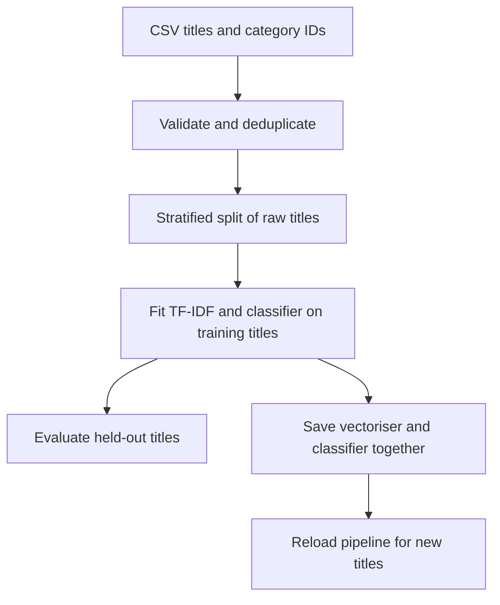

# Workflow and Models

[Project overview](../README.md) · [Training data](../data/README.md) · [Historical results](historical-results.md)

## From Titles to Predictions



TF-IDF represents words as numerical features using their frequency in a title and across the training collection. The classifier learns patterns between those features and the category-derived labels. Fitting TF-IDF after the split keeps held-out titles out of the learned vocabulary and IDF weights.

## Choose a Model

| `--model` | Algorithm |
|---|---|
| `random-forest` | Random Forest, the default |
| `naive-bayes` | Multinomial Naive Bayes |
| `svm` | Support Vector Classifier |
| `knn` | K-Nearest Neighbours |
| `decision-tree` | Decision Tree |
| `xgboost` | XGBoost, an optional dependency |

The first five use scikit-learn. KNN needs at least five training rows with its current default configuration. Install `requirements-optional.txt` for XGBoost and notebook tools.

```bash
python predict.py train --data data/videos.csv --model naive-bayes --seed 42 --test-size 0.2 --output-dir artifacts/naive-bayes
```

Use separate output directories when comparing models. Choose models with a validation set or cross-validation, then reserve an untouched test set for the final evaluation.

## Saved Outputs

| File | Contents |
|---|---|
| `pipeline.joblib` | Fitted TF-IDF vectoriser and classifier |
| `metrics.json` | Scores, confusion matrix, majority baseline, split settings, class counts, duplicate count, dataset hash and scikit-learn version |

```bash
python predict.py predict --artifact artifacts/naive-bayes/pipeline.joblib --title "An algebra lesson" --title "A music concert"
```

Prediction accepts title text, not a YouTube URL. The output gives the title, binary label and category-proxy name. Load only model artifacts you created or trust, because joblib deserialises Python objects.

## Reading the Metrics

Accuracy measures the fraction of correct category-proxy predictions. Precision, recall and F1 help explain errors in the positive class. Balanced accuracy gives both classes equal weight, and the majority baseline helps show whether the model improves on always choosing the most frequent class.

The confusion matrix uses `[0, 1]` label order. The report also records a seed, train/test class counts and a dataset hash. `synthetic_demo` identifies runs where every input row is marked synthetic; a demo score does not establish real-data performance.

## Existing Checks

```bash
python -m unittest discover -s tests -v
```

The four checks cover held-out vocabulary isolation, contradictory duplicate labels, missing CSV columns and training/saving/reloading/predicting with the synthetic sample. Evaluating model quality requires a separate real-data experiment.
